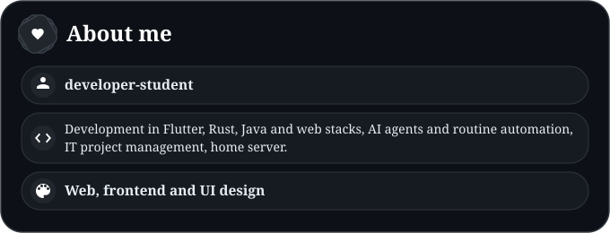
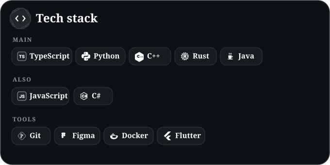
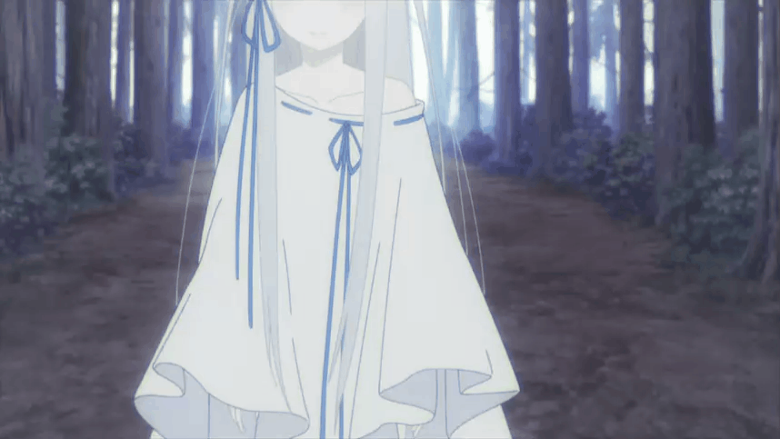

<!-- Header Banner (Material 3 Curved Expressive) -->

<!-- Dynamic Typing SVG Headline -->

 

<!-- Social Badges (Monochrome M3 Expressive Pills) -->

  
  
  
  
  

---

<!-- M3 Expressive Card: About me -->

  

<!-- M3 Expressive Card: Tech stack -->

  

<!-- Pandora Animation -->

---

### ✦ Статистика GitHub | Dynamic Metrics

<table>
  <tr>
    <td align="center">
      
    </td>
    <td align="center">
      
    </td>
  </tr>
  <tr>
    <td colspan="2" align="center">
      
    </td>
  </tr>
</table>

---

<!-- Footer Wave -->

